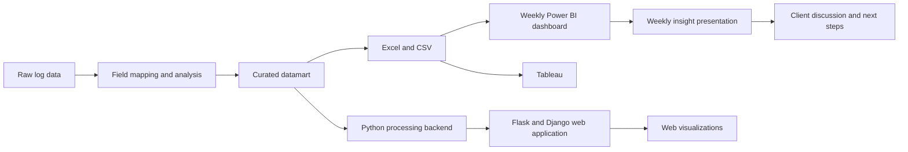

## Project overview

During my Technology Internship at Accenture, I supported the Data Analytics team on a telecommunications project. My work covered mapping available data to the client’s goals and metrics, ingesting raw data, transforming it into a datamart, and building visualizations.

Alongside this analytical work, I was challenged to develop a solution that could make the process more efficient. I connected a Python-based data-processing program to a web-based visualization layer, helping reduce the need to manually export data from a local database to CSV and Excel before loading it into Power BI.

The web application served as a presentation of the solution and demonstrated how the process could be streamlined. The main client deliverable was a Power BI dashboard, which was updated and shared weekly together with an insight presentation.

## The problem

The main challenge was to make customer-behavior information easier to review, compare, and explain. Relevant data was spread across several platforms, including Splunk, Firebase, and databases, with each source using different structures and formats.

The client needed flexibility to monitor a range of metrics and evaluate experiments against business goals. These metrics were grouped into areas such as promotion-related user experience, promotion engagement and realization, and the customer funnel for promotions.

The preparation process was also constrained by the available tools and the processing capacity of the work laptop. Using DBeaver to retrieve the data from the local database, prepare it, and export it to Excel or CSV could take approximately two to three hours. This made a more streamlined and repeatable process valuable for the weekly reporting cycle.

## My contribution

My work included:

- Discussing requirements with the client and project team, participating in design-thinking sessions, and presenting ideas for how the information could be delivered and visualized.
- Working on the ETL process: ingesting raw data from different platforms, mapping the available fields, translating the mapping into SQL queries, and transforming the results into a datamart for Power BI reporting.
- Building a Python-based web application that connected to a local database, processed the data into a datamart, and presented it through a customizable monitoring dashboard using Flask, Django, and Plotly.

## Solution

The solution started with raw log data from several platforms. I mapped the available fields to the client’s goals and metrics, analyzed the data structure, and transformed the results into a consistent datamart. The datamart then supported two complementary delivery paths:

1. **Curated datamart for reporting:** The cleaned and organized data was exported to Excel and CSV files, which were then used as inputs for the Power BI dashboard. Power BI was the main client deliverable and was updated weekly to support regular discussions with the client. Tableau was also part of the available visualization approach.
2. **Python-based web application:** I also developed a Python processing backend that connected to the local database and created the datamart. A web application built with Flask and Django then used the processed data to generate interactive visualizations through a customizable monitoring dashboard. This web application presented the proposed solution and demonstrated an alternative way to visualize the same data; it was not the primary production deliverable.

This approach separated data preparation from visualization. The same curated datamart could support the weekly Power BI deliverable, the insight presentation, and the web-based demonstration. It also reduced the need to repeat the full manual preparation process each time the data was refreshed.

## Technical implementation

The implementation used:

- **Languages:** Python, SQL, HTML, JavaScript, and CSS
- **Data preparation:** ETL, SQL queries, and datamart design
- **Web application:** Django, Flask, HTML, CSS, JavaScript, and Plotly
- **Business intelligence:** Power BI, Tableau, and DAX
- **Data sources:** SQL Server, Splunk, and Firebase

## Outcome and lessons learned

The project supported a repeatable weekly reporting process for the client. The curated datamart fed the Power BI dashboard, which was the main deliverable, while the web application demonstrated how the same data could be processed and presented through a custom solution.

The web application reduced this manual process by connecting directly to the local database and processing the data through the Python backend. This removed the need to complete the full DBeaver-to-Excel or CSV workflow before preparing the visualization. The weekly Power BI dashboard was accompanied by an insight presentation, giving the client data-backed information to discuss next steps, adjust a new approach, or continue with an existing plan.

The metrics were organized around different promotion-related goals, including user experience, promotion engagement and realization, and the customer funnel. This helped connect the dashboard to specific business questions rather than presenting the data as a collection of disconnected charts.

## Reflection

This internship showed me that a successful data solution is not only about producing accurate analysis. It also needs to fit the way people work, answer the questions that matter to the business, and present information in a form that users can understand.

I also learned the value of clarifying requirements before building a solution. By understanding the client’s goals, available data, and preferred ways of working, I could connect the data-processing work to a practical reporting and monitoring experience. This was an important early step in learning how to combine technical implementation with business and user needs.
