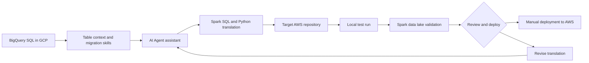

## Project overview

As a Data Engineer at Grab, I led an AI-assisted effort to migrate data pipelines from GCP to AWS. The wider platform initiative aimed to reduce cost by consolidating workloads on AWS, including the company's Indonesia-based cloud platform, while meeting a Q4 2025 delivery target after the project started in mid-Q2 2025.

The migration was not a direct platform swap. GCP pipelines relied heavily on managed services such as BigQuery, while the AWS environment used a mature, internally customized Spark Cluster platform for data processing. I led the design of an AI Agent assistant that translated BigQuery SQL into Spark SQL and Python, giving engineers a faster starting point for rebuilding and validating each pipeline in AWS.

## The problem

Migrating the pipelines manually would require engineers to translate queries, adapt data types and functions, account for differences in CTE behavior, and repeatedly test the result against the target Spark data lake. With a Q4 deadline, the manual approach would make it difficult to move quickly while preserving expected table outputs and business logic.

The AI assistant needed more than a generic SQL conversion prompt. It needed clear table context from GCP, migration-specific skills, and a test baseline that defined how common SQL constructs should be translated. The output also needed to fit the conventions and execution model of the customized Spark platform in AWS.

## My contribution

- Led the design of the AI-assisted SQL translation workflow for the GCP-to-AWS migration.
- Created structured GCP table context so the assistant could produce output aligned with the target AWS tables.
- Developed SQL skills and tests covering data-type conversion, function translation, and CTE behavior.
- Evaluated GPT and Claude models and standardized on the approaches that produced more direct output with less hallucination for this use case.
- Connected the assistant to the target AWS repository and supported local test runs against the Spark data lake.
- Kept manual deployment and final review in the workflow before production release.

## Solution

The workflow started with the original BigQuery SQL. We triggered the AI assistant with the relevant table context and migration skills, then ran the generated Spark SQL or Python in the target AWS repository. Engineers could test the query locally while connected to the Spark data lake and compare whether the result matched expectations. After a final manual review, the migration was deployed to production in AWS.

## Technical implementation

- **Source platform:** GCP and BigQuery SQL.
- **Target platform:** AWS Indonesia cloud platform and an internally customized Spark Cluster platform.
- **Translation output:** Spark SQL and Python.
- **AI workflow:** AI Agent assistant with table context, SQL translation skills, and a test baseline.
- **Validation:** Local execution against the Spark data lake, followed by manual review and deployment.

## Outcome and lessons learned

The AI-assisted workflow reduced the time to produce a migration-ready query from approximately 3–4 hours of query building and testing to about 1 hour. This helped the team move faster within the Q4 migration timeline while retaining local validation, manual review, and controlled production deployment.

The project also established a repeatable way to evaluate translation quality. Instead of treating the model output as a finished migration, the team used table context, reusable skills, and tests to make the output more consistent and easier to review.

## Reflection

The project showed that AI can accelerate a platform migration when the surrounding context is designed carefully. Table definitions, target-platform conventions, reusable SQL skills, and tests were as important as the choice between GPT and Claude.

The assistant shortened the repetitive part of the work, but engineering ownership remained essential. Local execution, result validation, final review, and manual deployment kept the migration reliable while allowing the team to benefit from AI-assisted translation.
