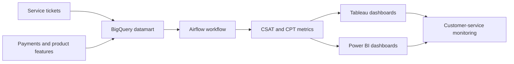

## Project overview

As a Business Intelligence / Data Analyst at OVO/Grab, I built a datamart pipeline to monitor customer-service metrics. The analysis connected customer-service tickets with payment and product features so stakeholders could understand how service demand related to the customer experience.

I used BigQuery and Airflow for the data workflow and created monitoring dashboards in Tableau and Power BI. The dashboards focused on CSAT (Customer Satisfaction) and CPT (Contact per Transaction).

## The problem

Customer-service metrics are more useful when they can be viewed alongside the product and payment context behind the contact. Without a connected datamart, stakeholders had less visibility into how tickets related to specific features and how service performance was changing.

## My contribution

- Built a customer-service datamart pipeline with BigQuery and Airflow.
- Connected customer-service tickets with payment and product features.
- Defined monitoring views for CSAT and CPT.
- Created Tableau dashboards for customer-service stakeholders.
- Created Power BI dashboards to broaden monitoring of key metrics.

## Solution

The main deliverable was the customer-service datamart and its monitoring dashboards. Tableau and Power BI presented CSAT and CPT in a form that customer-service stakeholders could use for ongoing review.

## Technical implementation

- **Data warehouse:** BigQuery.
- **Orchestration:** Airflow.
- **Data modeling:** Customer-service, payment, and product-feature relationships.
- **Visualization:** Tableau and Power BI.
- **Metrics:** CSAT and CPT.

## Outcome and lessons learned

The project gave customer-service stakeholders a connected view of tickets, payments, and product features, with dashboards for monitoring CSAT and CPT.

No numerical impact is claimed because the available project details do not include validated measures for service improvement, dashboard adoption, or metric change.

## Reflection

Customer-service analysis becomes more actionable when it connects operational contacts to the product and payment experience. A focused datamart made those relationships easier to monitor consistently.
