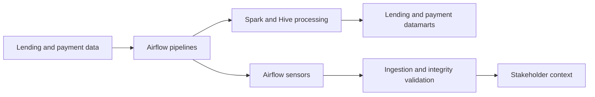

## Project overview

As a Data Engineer at Grab, I maintained and optimized critical data pipelines for lending and payment transactions. The workflows ran through Apache Airflow across GCP and AWS environments and used Spark and Hive for processing.

I also developed Airflow sensor functions to validate data ingestion, uphold data integrity, and provide stakeholders with context about lending and payment datamarts.

## The problem

Lending and payment datamarts depend on reliable ingestion and processing. A pipeline can complete technically while still producing incomplete or invalid data, so the workflow needed checks that could identify integrity problems and make them visible to the people responsible for downstream use.

## My contribution

- Maintained and optimized lending and payment data pipelines across GCP and AWS.
- Used Airflow to coordinate recurring data workflows.
- Used Spark and Hive for data processing.
- Developed Airflow sensor functions to validate ingestion and data integrity.
- Provided context to stakeholders about the state of lending and payment datamarts.

## Solution

The main deliverable was the maintained pipeline and its data-integrity monitoring. Airflow sensors added validation around ingestion and gave stakeholders useful context when reviewing the datamarts.

## Technical implementation

- **Cloud environments:** GCP and AWS.
- **Orchestration:** Apache Airflow.
- **Processing:** Spark and Hive.
- **Quality monitoring:** Custom Airflow sensor functions for ingestion and integrity checks.

## Outcome and lessons learned

The work supported reliable operation of lending and payment data pipelines and improved visibility into the integrity of their datamarts. It also reinforced that pipeline monitoring should explain the state of the data, not only whether a task succeeded.

No numerical impact is claimed because the available project details do not include validated measures for failures avoided, cost reduction, or recovery time.

## Reflection

Data-quality checks are most useful when they are close to the point where data enters a workflow. Combining sensors with stakeholder context made the monitoring more actionable for both engineering and data users.
