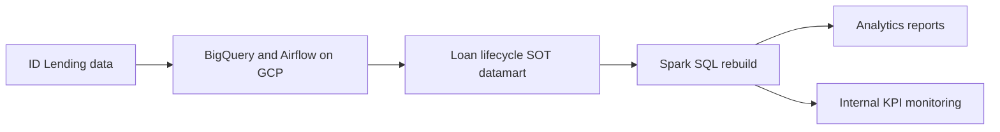

## Project overview

As a Business Intelligence / Data Analyst at OVO/Grab, I developed a Single Source of Truth (SOT) datamart pipeline for ID Lending. The datamart tracked the loan lifecycle from disbursement to repayment.

The pipeline began with BigQuery and Airflow on GCP for regulatory-compliance needs and was later migrated and rebuilt in Spark SQL. The result gave the Analytics team a more consistent foundation for downstream reports and internal KPI monitoring.

## The problem

Lending teams needed a complete view of the loan lifecycle, while Analytics needed a dependable dataset for downstream reports and KPIs. The data product also had to evolve from its initial BigQuery and Airflow implementation into a Spark SQL solution.

## My contribution

- Developed the ID Lending SOT datamart pipeline.
- Modeled the loan lifecycle from disbursement through repayment.
- Built the initial pipeline with BigQuery and Airflow on GCP.
- Rebuilt the pipeline in Spark SQL.
- Supported downstream reports and internal KPI monitoring for the Analytics team.

## Solution

The main deliverable was the Lending SOT datamart pipeline. It provided a single lifecycle view and was rebuilt in Spark SQL to support the Analytics team’s downstream reporting and KPI monitoring.

## Technical implementation

- **Initial platform:** BigQuery on GCP.
- **Orchestration:** Airflow.
- **Rebuilt processing:** Spark SQL.
- **Data product:** Single Source of Truth datamart for ID Lending.
- **Business scope:** Loan lifecycle from disbursement to repayment.

## Outcome and lessons learned

The project created a consistent SOT view of the ID Lending lifecycle and provided the Analytics team with a foundation for downstream reports and internal KPI monitoring.

No numerical impact is claimed because the available project details do not include validated measures for report adoption, query performance, or KPI outcomes.

## Reflection

A single source of truth is valuable when it represents the business lifecycle clearly. In this case, modeling lending from disbursement to repayment gave downstream users a shared structure for reporting and monitoring.
