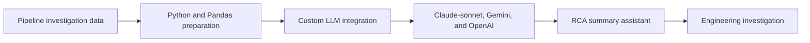

## Project overview

As a Data Engineer at Grab, I developed and launched LLM solutions to support root-cause analysis (RCA) for data pipeline issues. The work focused on preparing useful operational data and connecting it with custom language-model solutions.

The resulting assistants were designed to produce RCA summaries, giving engineers and stakeholders a more structured starting point when investigating pipeline problems.

## The problem

Pipeline investigations can require engineers to collect context from multiple technical signals before they can explain what happened. This makes RCA summaries time-consuming and can make incident communication inconsistent.

The solution needed prepared input data and a tailored interface to the language models so that generated summaries were grounded in the pipeline context available to the team.

## My contribution

- Developed and launched LLM solutions for pipeline RCA summaries.
- Prepared data with Python and Pandas for integration with custom LLM models.
- Created tailored assistants for root-cause analysis use cases.
- Worked with Claude-sonnet, Gemini, and OpenAI models.
- Connected the resulting summaries to the needs of data pipeline investigation.

## Solution

The main deliverable was a set of tailored assistants and the supporting data-preparation flow. The LLM output was an intermediate investigation aid, helping organize root-cause context rather than replacing engineering review.

## Technical implementation

- **Data preparation:** Python and Pandas.
- **AI integration:** Custom LLM integrations.
- **Models:** Claude-sonnet, Gemini, and OpenAI.
- **Use case:** Root-cause analysis summaries for data pipeline investigations.

## Outcome and lessons learned

The project launched AI-assisted support for pipeline RCA summaries. It gave engineers a structured way to review available context during investigation while keeping the final diagnosis and action with the engineering team.

No numerical impact is claimed because the available project details do not include validated measures for investigation time, summary accuracy, or adoption.

## Reflection

An AI assistant is only as useful as the operational context supplied to it. Preparing and shaping the data before model integration was as important as selecting the model itself.
