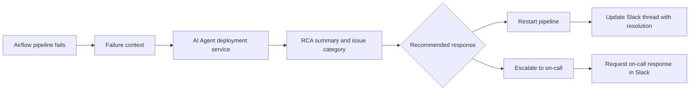

## Project overview

As a Data Engineer at Grab, I worked on the early adoption of LLMs for data-platform operations. The project extended our existing Airflow-based pipeline orchestration with an AI assistant, using the internal AI Agent deployment service to help teams understand and respond to failed pipelines.

Whenever an Airflow pipeline stopped because of a failure, the agent was triggered to summarize what happened, categorize the issue, and recommend the next action. It could distinguish between categories such as infrastructure errors, intermittent errors, user errors, and data-source errors. It also used operational skills to assess whether a failure could be addressed by restarting the pipeline or should be escalated to the on-call team for further investigation.

## The problem

When a pipeline failed, engineers had to monitor the run, gather the relevant task and error context, determine the likely failure category, and decide whether to retry or involve the on-call team. Repeating this process manually made monitoring costly and made it harder to build a consistent record of what happened across incidents.

The goal was to make the first response more systematic without removing engineering judgment. The assistant needed to use the context already available from Airflow, explain the failure in a useful summary, classify the issue, and make the recommended response visible to the team.

## My contribution

- Designed an Airflow-triggered AI assistant for failed pipeline runs.
- Connected pipeline task and error context to the internal AI Agent deployment service.
- Defined issue categories including infrastructure, intermittent, user, and data-source errors.
- Imbued the agent with skills to recommend a pipeline restart or escalation to the on-call team.
- Integrated Airflow and the agent with Slack so investigation summaries and follow-up discussions were documented in the relevant channel.

## Solution

The main deliverable was an Airflow-connected AI assistant that helped the team move from a failed run to a structured first response. The agent summarized the incident, categorized the likely cause, and suggested whether to restart the pipeline or escalate the issue. Slack integration kept the summary and discussion together in the monitoring channel, creating a more useful operational record.

## Technical implementation

- **Orchestration:** Apache Airflow, including pipeline task and failure context.
- **AI integration:** Internal AI Agent deployment service.
- **Operational workflow:** Failure-triggered RCA, issue categorization, restart-or-escalate recommendations, and Slack collaboration.

## Outcome and lessons learned

The project reduced manual pipeline monitoring effort by 70% by automating the first layer of failure understanding and response guidance. It also made recurring failure patterns easier to observe through consistent categorization and Slack documentation, helping the team understand what happened more often across its pipelines.

## Reflection

This project showed how an AI assistant can add value to an existing operational workflow when it is triggered by the right event and given practical skills. The assistant supported engineering judgment rather than replacing it: it made the first response faster and more consistent, while the on-call team remained responsible for deeper investigation and fixes when needed.
