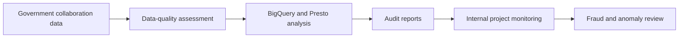

## Project overview

As a Business Intelligence / Data Analyst at OVO/Grab, I performed data-quality assessments and data modeling for government-collaboration projects. I used BigQuery on GCP and Presto to prepare information for regulatory compliance and audit reporting.

The work supported internal monitoring of government projects and helped audit teams detect and prevent fraudulent or anomalous transactions.

## The problem

Government-collaboration projects required reliable data for strict regulatory compliance. Data-quality issues or inconsistent models could make it difficult for audit teams to monitor projects and identify transactions that needed investigation.

## My contribution

- Performed data-quality assessments for government-collaboration data.
- Modeled data in BigQuery on GCP and queried data with Presto.
- Generated reports for audit teams.
- Supported internal monitoring of government projects.
- Enabled detection and prevention of fraudulent and anomalous transactions through data-backed review.

## Solution

The main deliverable was the assessed and modeled data together with audit reports for internal monitoring. These outputs gave audit teams a clearer basis for reviewing government-collaboration projects.

## Technical implementation

- **Data platform:** BigQuery on GCP.
- **Query engine:** Presto.
- **Data quality:** Data-quality assessment and modeling.
- **Reporting:** Audit reports for internal project monitoring.

## Outcome and lessons learned

The project supported regulatory compliance monitoring and gave audit teams data-backed reports for reviewing government projects and investigating fraudulent or anomalous transactions.

No numerical impact is claimed because the available project details do not include validated measures for findings, prevented losses, or review time saved.

## Reflection

Compliance analytics begins with confidence in the data. Assessing quality before modeling and reporting made the resulting monitoring more useful for audit teams.
