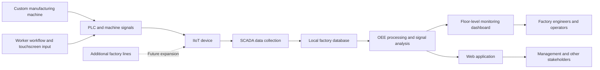

## Project overview

During my Engineering Internship at PT Mattel Indonesia from January to May
2019, I worked with the Automation Engineer. Here the team are more focus on innovating things that are related to machinery, automation, robotic, anything mechanical to improve the factory.

Even as I was an intern, I was given responsible to some metrics in the project focused on IoT Initiave. Its purpose was to implement an IoT ideas as the showcase for Industry 4.0 that was starting to booming in Industry sector across Indonesia.

## The problem

Before the project, we are eager to create some kind of interconnected machinery via internet so we can monitor all the machine and robot inside factory. The problem is that all the machinery are still fully mechanical and unfortunately fully customized for this particular factory. In addition, there are some issue where sometimes we didn't know on what causing problem on some line in the machinery. For example, some production line are delayed causing the production target are not met, this sometime giving clash between the workers, mechanic, and the machine since we don't know where is the real problem. We don't even know what the real cause since the work are mostly done by human in the machine and reported manually by human. This approach are prone to be wrong or manipulated.

## My contribution

- Working with the team on starting how we gather the data, finding the real device that can be Integrate with our current machine and understand to give signal that can be processed.
- Develop a workflow that enhance human capabilities to work with the machine, such as add interactive touchscreen to start the working procedure. This help us teach the worker a new way of working to help us gather the data.
- Working alongside machine engineers connecting the machine with IoT device and SCADA. Create a tech framework inside the machine that help us to get data and flagging that can we map. Also plan the integration on how we can integrate this machine in local network so it can communicate.
- Understand the metrics that we want to monitor in OEE (Overall Equipment Effectiveness) then create a data ingestion pipeline and web based application can store the machine log signal data, then process it in the backend, and produce a highly visual web application dashboard that has a realtime data.

## Solution

The solution followed this flow:

### OEE monitoring

The OEE monitoring dashboard provided factory-floor visibility into the overall
condition and effectiveness of the monitored equipment. It also supported
machine-level analysis, including comparisons of machine behaviour across
shifts. The data was available with an approximately 10–15 minute delay rather
than requiring workers to wait for a manual report.

Alongside the floor-level dashboard, we developed a web application for
managers and other stakeholders. This provided a higher-level view of OEE and
allowed the information to be broken down by hour for operational review.

### IIoT flow

The IIoT implementation was designed as a starter project that could later be
extended to other factory lines. Because the machines were custom-built and had
not originally been designed for this type of monitoring, the first step was to
add an IIoT device with SCADA support and connect it to the existing equipment.

We also helped define a standard operating workflow for workers using the
machine. The workflow included an interactive touchscreen and gave workers a
consistent way to trigger signals representing machine activity and behaviour.
Those signals were collected through SCADA, ingested into the local factory
database, and made available to teams across the factory. The data stored on the
factory server then supported a web application with more customizable views
for different users and stakeholders.

### Main deliverable and prototype scope

- **Main deliverable:** A floor-level OEE monitoring dashboard providing near-real-time equipment visibility, together with a web application for higher-level monitoring and issue flagging to the appropriate person in charge. The project also established a foundation for web-based data integration that could collect monitoring data from additional factory lines and extend visibility from the factory floor to top management.
- **Supporting output:** A standardized worker workflow designed to produce machine-behaviour data that aligned with the selected OEE metrics.
- **Prototype or demonstration:** A starter IIoT implementation for the initial monitored line, intended to provide a foundation for future factory-line expansion. 

## Technical implementation

- **Languages:** SQL, PHP, HTML, CSS, and JavaScript
- **SCADA:** A SCADA application connected to the added IIoT device; the specific product name is not recorded in this draft
- **Data collection/integration:** Machine signals, PLC connectivity, equipment communication, database signal processing, and data storage
- **Data preparation/calculation:** Python and PHP for processing and OEE-related calculations
- **Database/storage:** Local factory production database and factory server; the specific database product is not recorded in this draft
- **Web application:** CodeIgniter and Bootstrap
- **Visualization:** HTML, CSS, JavaScript charts, and Power BI
- **Hardware/equipment:** Custom-built manufacturing machinery, PLCs, sensors, and an IIoT/SCADA device

## Outcome

The project helped the Automation Engineering team and factory stakeholders
monitor equipment behaviour with more timely and consistent information. Floor
workers could use the monitoring interface and standardized workflow to produce
machine signals, while engineers and other stakeholders could review the data
through dashboards and the web application.

The process changed from relying mainly on manual worker reports and limited
visibility into machine problems to collecting machine-related signals through
an IIoT and SCADA setup, storing them in the factory environment, and presenting
them through floor-level and higher-level monitoring interfaces. This made it
easier to discuss machine behaviour, identify potential issues, and compare
performance by machine and shift.

The initial implementation served as a practical Industry 4.0 showcase and a
foundation for considering similar monitoring on additional factory lines. No
validated numerical reduction in downtime, reporting time, or production loss
has been recorded in this case study.

## Lessons learned

This project taught me that industrial analytics depends on the physical
workflow as much as on the software. Because the machines were custom-built and
the original process depended heavily on human reporting, collecting useful
data required collaboration with machine engineers and a practical workflow
for the workers operating the equipment.

I also learned that an effective monitoring solution needs several connected
layers: equipment signals, a reliable collection method, data processing and
storage, and interfaces suited to different users. Building both floor-level
and higher-level views helped me understand how the same operational data can
support immediate monitoring and broader management discussions.

If I worked on it again, I would strengthen the rollout plan for additional
factory lines, document the signal definitions more formally, and establish
clear validation rules for OEE data. I would also confirm measurable baseline
metrics so that the effect of the monitoring system could be evaluated beyond
its qualitative benefits.

