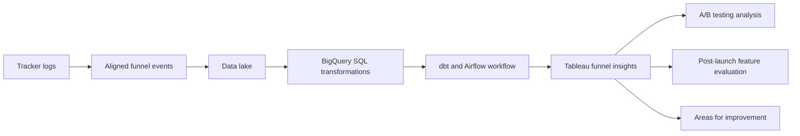

## Project overview

During my Business Intelligence / Data Analyst work from January 2022 to October 2023, I developed a funnel data insight solution. The project aligned tracker logs and centralized data in a data lake to support A/B testing and post-launch feature evaluation.

The work gave product teams a way to monitor customer-funnel behavior through Tableau, assess feature impact, evaluate launch success, and identify areas for improvement.

## The problem

Feature evaluation required teams to connect tracker logs with the stages of a customer funnel. When those logs were not aligned and centralized, it was harder to compare A/B tests, understand post-launch behavior, and determine where a feature was helping or losing users.

The analysis needed a consistent path from event tracking to funnel insight so product teams could monitor changes over time.

## My contribution

- Aligned tracker logs with the stages needed for customer-funnel analysis.
- Centralized the data in a data lake for consistent reporting.
- Built BigQuery SQL transformations for funnel and experiment analysis.
- Used dbt and Airflow to organize and coordinate the data workflow.
- Delivered Tableau visualizations for A/B testing, post-launch evaluation, and feature monitoring.

## Solution

The main deliverable was the centralized data workflow and resulting Tableau funnel views. These outputs supported both A/B testing analysis and post-launch feature evaluation.

## Technical implementation

- **Data source:** Tracker logs aligned and centralized in a data lake.
- **Data warehouse:** BigQuery SQL for funnel and experiment analysis.
- **Transformation:** dbt for reusable transformation logic.
- **Orchestration:** Airflow for the recurring data workflow.
- **Visualization:** Tableau for customer-funnel behavior and feature impact.

## Outcome and lessons learned

The project gave product teams a clearer way to evaluate features before and after launch. Tableau funnel insights supported A/B testing, success assessment, continuous monitoring of feature impact, and identification of areas for improvement.

No numerical impact is claimed because the available project details do not include validated measures for experiment lift, feature adoption, or funnel conversion changes.

## Reflection

Product analytics depends on trustworthy event definitions. Aligning tracker logs before analyzing a funnel makes comparisons easier to interpret and reuse.

The work also reinforced that analysis should continue after launch. Ongoing monitoring can reveal new opportunities or problems even after a feature meets its initial success criteria.
