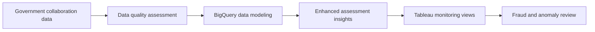

## Project overview

From January 2022 to October 2023, I worked as a Business Intelligence / Data Analyst. One project supported regulatory compliance for government collaborations through data quality assessments, BigQuery modeling, and enhanced Tableau monitoring insights.

The work helped internal teams review government projects with more consistent information and identify potential fraud or anomalous transactions for follow-up.

## The problem

Government collaborations required close attention to regulatory compliance and the quality of the underlying data. Inconsistent or unclear information could make it harder to monitor projects and recognize transactions that needed investigation.

The teams needed a structured analytical foundation and visual insights that made compliance review, fraud detection, and anomaly detection easier to perform.

## My contribution

- Performed data quality assessments for government-collaboration data.
- Modeled the data in BigQuery on Google Cloud Platform (GCP).
- Developed enhanced assessment insights for internal project monitoring.
- Visualized the insights in Tableau for internal stakeholders.
- Supported the detection and prevention of fraudulent and anomalous transactions.

## Solution

The main deliverable was the BigQuery analytical foundation and Tableau monitoring view. Together, they gave internal teams clearer information for reviewing government projects and investigating unusual activity.

## Technical implementation

- **Data platform:** BigQuery on Google Cloud Platform (GCP).
- **Data quality:** Assessments to establish whether information was suitable for compliance monitoring.
- **Visualization:** Tableau for enhanced assessment insights and internal review.

## Outcome and lessons learned

The project supported stricter compliance monitoring for government collaborations. Internal teams received enhanced Tableau insights that helped them detect and prevent fraud and anomalous transactions.

No numerical impact is claimed because the available project details do not include validated measures for findings, prevented losses, or review time saved.

## Reflection

This work showed me that compliance analytics depends on data quality as much as visualization. A dashboard can make a risk visible, but only when the underlying data has been assessed and modeled carefully enough to support trust in the review.
