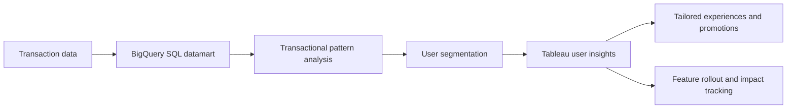

## Project overview

During my Business Intelligence / Data Analyst work from January 2022 to October 2023, I developed a user-experience data product. The project provided rapid insight into transaction behavior through a high-volume BigQuery SQL datamart.

The analysis helped product teams understand transactional patterns, create precise user segments, and shape tailored user experiences, offerings, and promotions. It also helped technology teams plan feature rollouts and track their impact on user behavior.

## The problem

Transaction data contained useful signals about user behavior, but product and technology teams needed those signals in a form that could be explored quickly and applied to their work. Without a dedicated datamart, analyzing high-volume behavior and comparing user segments could require repeated preparation.

The teams needed a reusable view of transaction behavior that connected analysis to product decisions and feature impact tracking.

## My contribution

- Developed a high-volume BigQuery SQL datamart for transaction behavior.
- Structured transactional patterns into reusable analytical views.
- Enabled more precise user segmentation for product analysis.
- Built Tableau visualizations for exploring user behavior and segments.
- Supported product and technology teams with insights for offerings, promotions, feature rollouts, and impact tracking.

## Solution

The main deliverable was the BigQuery SQL datamart. Tableau provided the visualization output for exploring segments and transactional behavior, while the insights supported product and technology discussions.

## Technical implementation

- **Data warehouse:** BigQuery for the high-volume SQL datamart.
- **Data preparation:** SQL transformations for reusable analytical views.
- **Analysis:** Transactional patterns and user segmentation.
- **Visualization:** Tableau for product and technology teams.

## Outcome and lessons learned

The project gave product teams a more structured way to understand transaction behavior and user segments. The insights supported tailored experiences, optimized offerings, targeted promotions, feature rollouts, and tracking changes in user behavior.

No numerical impact is claimed because the available project details do not include validated measures for query performance, adoption, conversion, or feature impact.

## Reflection

User-experience analytics is most useful when it connects behavioral patterns to decisions a product team can make. A reusable datamart allowed teams to spend more time interpreting behavior and less time rebuilding the same view of the data.
