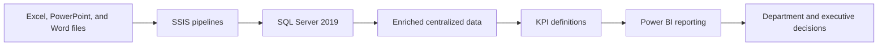

## Project overview

As a Data Analytics Associate at PwC Indonesia, I modernized a rigid legacy data infrastructure for a travel agency. The work focused on transforming scattered transactional information from manual Excel, PowerPoint, and Word files into a centralized system that could support more efficient reporting.

I implemented SSIS pipelines in SQL Server 2019, enriched the existing data, and developed Power BI reporting for different stakeholder groups. The resulting information was tailored for business development, customer relations, and executive leadership.

## The problem

The travel agency's transactional data was spread across manually maintained files and a rigid legacy SQL Server environment. This made it difficult to create a consistent view of performance and to provide each department with reporting relevant to its decisions.

The organization needed a more centralized and efficient way to prepare data, enrich existing records, and present key performance indicators to operational and executive stakeholders.

## My contribution

- Assessed how transactional information was distributed across Excel, PowerPoint, Word, and the existing SQL Server 2019 environment.
- Designed and implemented SSIS SQL Server pipelines to automate data movement and preparation.
- Centralized and enriched the available data for reporting across multiple stakeholder groups.
- Developed key performance indicators and Power BI visualizations for business development, customer relations, and executive leadership.
- Tailored reporting views to the different questions and decision needs of each department.

## Solution

The modernization flow connected manual source files to a centralized reporting system:

The main deliverable was a centralized data and business-intelligence foundation. SSIS automated the data pipeline into SQL Server, while Power BI provided reporting tailored to business development, customer relations, and leadership. The dashboards were the reporting output of the modernization work, not a separate prototype.

## Technical implementation

- **Data infrastructure:** Microsoft SQL Server 2019 as the centralized data environment.
- **Data preparation:** SQL Server Integration Services (SSIS) to automate data pipelines and enrich existing transactional data.
- **Source formats:** Manual Excel, PowerPoint, and Word files supplied by the business.
- **Business intelligence:** Power BI for KPI visualization and stakeholder-specific reporting.

## Outcome and lessons learned

The project replaced a scattered manual-file process with a more centralized and automated reporting flow. It gave business development, customer relations, and executive leadership access to KPI reporting and insights shaped around their different needs.

No numerical impact is claimed here because the available project details do not include validated measures for time saved, refresh frequency, or adoption.

## Reflection

Modernizing data infrastructure is as much about understanding how people use information as it is about implementing a pipeline. Centralizing the data created a stronger technical foundation, but tailoring the reporting to each stakeholder group made that foundation useful in day-to-day business discussions.

This project also reinforced the value of enriching data before visualization. A dashboard can display what is available, but clear KPI definitions and prepared data are what make the output consistent enough to support decisions.
