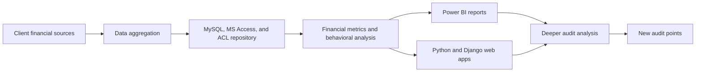

## Project overview

As a Data Analytics Associate at PwC Indonesia, I supported audit teams working with financial data from diverse client environments, including banking, insurance, travel, and oil and gas. The goal was to make fragmented financial information easier to combine, review, and analyze within an audit-compliant data repository.

My work covered data aggregation, financial metric development, behavioral analysis, and the delivery of reporting and web-based tools. The project supported deeper audit analysis and helped teams identify additional points for investigation.

## The problem

Financial data arrived from different client sources and in different structures. Without a unified repository, comparing information and applying consistent audit analysis required additional preparation and made it harder to explore patterns across the data.

Audit teams needed a practical way to bring the data together while maintaining an audit-compliant working environment. They also needed analysis that went beyond basic reporting, including financial metrics and behavioral insights that could support follow-up questions and new audit points.

## My contribution

- Aggregated financial data from diverse client sources across banking, insurance, travel, and oil and gas.
- Prepared a unified repository using MySQL, MS Access, and ACL for audit analytics workflows.
- Developed advanced financial metrics and behavioral insights to support deeper analysis.
- Built Power BI reports and custom Python/Django web applications for exploring the resulting information.
- Supported audit teams in using the analysis to identify additional points for investigation.

## Solution

The solution combined data preparation, audit analysis, and user-facing outputs:

The main deliverable was an audit analytics foundation that brought diverse financial data into a unified repository. Power BI provided visual analysis for reporting and review, while the custom Python/Django applications offered a more flexible way to explore metrics and behavioral insights.

## Technical implementation

- **Data repository:** MySQL and MS Access for organizing aggregated financial data, with ACL used in the audit analytics workflow.
- **Analysis:** Advanced financial metrics and behavioral analysis developed from the unified data.
- **Visualization:** Power BI reports for reviewing patterns, metrics, and potential areas for follow-up.
- **Applications:** Custom Python and Django web applications for interactive access to analytics.

## Outcome and lessons learned

The project gave audit teams a unified, audit-compliant basis for analyzing financial information from diverse client sources. It supported deeper financial and behavioral analysis and helped identify new audit points for further investigation.

No numerical impact is claimed here because the available project details do not include validated measures for time saved, findings identified, or adoption.

## Reflection

This work showed me that audit analytics is strongest when data preparation and investigation are designed as one workflow. A unified repository creates the foundation, but the value comes from turning that data into questions that audit teams can examine and act on.

It also strengthened my ability to adapt analytical outputs to different users. Power BI and custom web applications served complementary purposes: one supported visual reporting, while the other enabled more tailored exploration.
